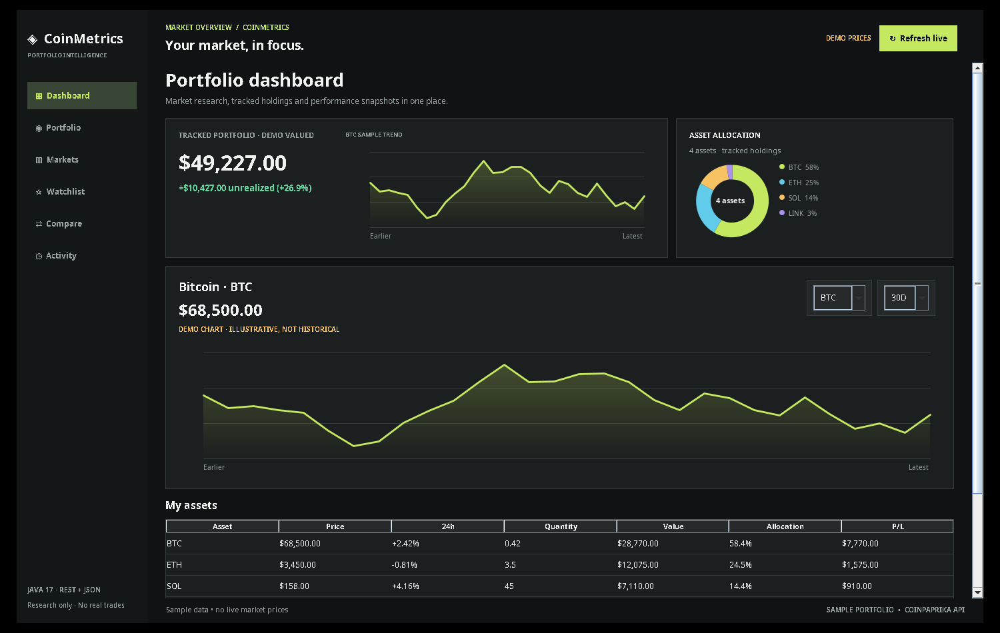

# CoinMetrics — Portfolio Intelligence Dashboard

[](https://github.com/nimrah-a/CoinMetrics/actions/workflows/java-ci.yml)

**Understand the market. Track your strategy.** A polished Java 17 desktop application for researching cryptocurrency markets, recording local portfolio positions, and comparing digital assets. Inspired by modern fintech interfaces, built with Java Swing and Java2D without third-party dependencies.



> **Demo-mode screenshot:** This image shows **illustrative prices and a sample portfolio**, not real balances or live quotes. It is an educational research/tracking application, **not an exchange or wallet**. No actual cryptocurrency is sent, purchased, or sold.

## Features

| View | What it does |
| --- | --- |
| **Dashboard** | Shows a tracked portfolio's current estimated value, unrealized gain/loss, allocation donut, BTC sample trend, configurable asset price chart, and holdings table. |
| **Portfolio** | Record hypothetical buy/sell entries, edit positions, remove positions, and calculate average-cost-based realized and unrealized P/L. No real orders are placed. |
| **Markets** | Search and sort 10 supported coins by USD price, 24-hour percentage change, market capitalization, and volume. |
| **Watchlist** | Add/remove assets; choices are saved across application restarts. |
| **Compare** | Side-by-side metrics for two selected assets. |
| **Activity** | Locally stored history of tracker changes, watchlist edits, and refresh attempts. |

**Interactive charts:** BTC/ETH/SOL and seven additional supported coins can be selected; historical views support 7D, 30D, and 90D. An API-history label appears only when actual provider history was obtained. Otherwise the chart says **DEMO CHART · ILLUSTRATIVE, NOT HISTORICAL**.

**Important chart distinction:** The large chart is an **individual asset's price trend**, not a reconstruction of your historical portfolio performance. The small chart in the summary is explicitly labeled **BTC SAMPLE TREND**. Real historical portfolio returns would require dated holdings/transaction history and synchronized price histories for each asset.

## Getting started

Requires **JDK 17 or newer**. Works on macOS, Linux, and Windows.

```bash
bash run.sh
```

On Windows, run `run.bat`. In IntelliJ IDEA, open the project folder and run `src/coinmetrics/Main.java`.

To execute the deterministic test suite:

```bash
bash test.sh
```

GitHub Actions uses the same script on pushes and pull requests. The V2 suite currently contains **54 assertions**. A real API response is **not** required for tests to pass.

## Getting real market data

Press **Refresh live** in the top-right corner. When a quote request succeeds, the status changes to **LIVE QUOTES** and the footer shows the refresh time. Prices, 24h changes, market cap, and volume come from the public [CoinPaprika](https://coinpaprika.com/developers) API. If the request fails, the app clearly switches to **DEMO PRICES** and sample data; it never silently passes off demo values as live.

The API client uses:

- `GET https://api.coinpaprika.com/v1/tickers?quotes=USD`
- `GET https://api.coinpaprika.com/v1/tickers/{id}/historical?start=...&interval=24h`

Data availability, freshness, and history access depend on provider rate limits and tier. No API key is required for the configured public endpoints, but access is not guaranteed. Requests are asynchronous to keep the interface responsive. **The live network integration hasn't been verified from this restricted environment**; test Refresh live on your own computer.

## Portfolio data and calculations

On the first launch, the application creates **four labeled example positions** for testing the interface. They are not real holdings. Positions are stored in the user's home directory:

- `~/.coinmetrics/holdings.csv` — quantities and total USD cost basis
- `~/.coinmetrics/watchlist.txt` — tracked tickers
- `~/.coinmetrics/activity.log` — local action history

Recorded buys add quantity and cost basis. Recorded sales reduce quantity and cost basis using a **weighted-average cost** method. The activity log records estimated realized P/L for sales. The dashboard shows **unrealized** P/L as (current quote × quantity − remaining basis), excluding fees, taxes, slippage and income. If prices are in demo mode, valuations are also demonstrative.

Transactions in this application are **manual portfolio accounting entries**, not broker orders or blockchain transactions. Entered amounts are not verified against exchange activity.

## Architecture

```text
src/coinmetrics/
  Core.java          Domain models, portfolio math, persistence, HTTP client, JSON parser
  Main.java          Swing dashboard, navigation, tables, portfolio forms, charts, donut

tests/coinmetrics/
  CoreTests.java     Arithmetic, validation, persistence, simulated trading and JSON checks

docs/
  dashboard-preview.png  V2 UI screenshot captured in demo mode

.github/workflows/
  java-ci.yml        CI using Java 17 and bash test.sh
```

### Notable engineering choices

- `SwingWorker` handles network I/O outside Swing's event-dispatch thread.
- `BigDecimal` is used for stored quantities, purchase cost and calculations.
- Input checks reject negative/invalid values and overselling tracked quantities.
- Portfolio and watchlist data persist locally, without credentials or private keys.
- Distinct UI badges keep live provider quotes and offline sample prices unmistakable.
- Swing table row sorters, search, editable positions, chart range controls and navigation provide actual interactions.

## Known limitations

- No exchange account connectivity, actual orders, deposits, withdrawals, or custody.
- No precise historical portfolio equity curve; a chart of an asset is not an equity curve.
- Activity entries are a lightweight local log, not a tax or audit ledger.
- No exchange fees, trading slippage, tax lots, or multi-currency conversion.
- A portfolio shown with demo quotes is **not** a reliable USD valuation.

## License

MIT. See [LICENSE](LICENSE).
